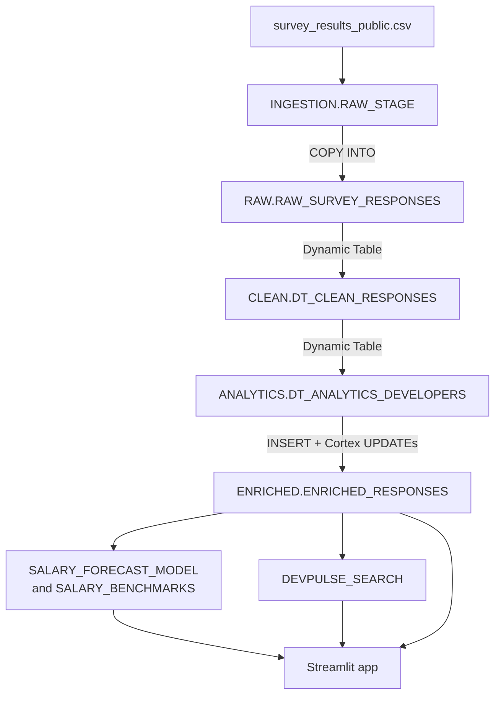

# DevPulseIntel

A **Snowflake Cortex capabilities demo** on the Stack Overflow Developer Survey 2024 (65,437 respondents). Every layer is Snowflake-native: no external orchestrator, storage, or compute. It also includes a documented post-build review.

> **Status:** Complete. Built May 2026 on a trial account that has since expired.
> The SQL and app code here are **what ran**, except `app.py`, which predates a small NaN fix made in the deployed app (Known Issue 8). Issues found afterward are documented under [Known Issues](#known-issues--post-build-review), not patched, so code, results, and screenshots stay consistent.

---

## What It Demonstrates

| Capability | Implementation |
|---|---|
| **Stage + pipe** | `RAW_STAGE` with CSV file format. `SURVEY_PIPE` defined (`AUTO_INGEST = FALSE`); load ran via manual `COPY INTO` |
| **Dynamic Tables** | RAW → CLEAN → ANALYTICS, `TARGET_LAG = '9999 days'`, refreshed manually once |
| **Cortex LLM** | `SENTIMENT` (job satisfaction) · `CLASSIFY_TEXT` (roles, AI attitude) · `COMPLETE` with `mistral-7b` (skill clusters) |
| **Cortex ML** | `FORECAST` with experience as a pseudo-time axis (capability demo, not a salary model) |
| **Cortex Search** | `DEVPULSE_SEARCH` over a composite profile text |
| **Streamlit in Snowflake** | Four pages on `DEVPULSE_APP_WH`: Salary Explorer, AI Adoption, Skill Demand, Semantic Search |

---

## Architecture



Object inventory: [`architecture.md`](./architecture.md) · Design rationale: [`decisions.md`](./decisions.md)

---

## Screenshots


---

## Project Structure

```
DevPulseIntel/
├── README.md
├── BRD.md
├── architecture.md
├── decisions.md
├── setup.md
├── DEVLOG.md
├── sql/
│   ├── 01_staging.sql
│   ├── 02_raw_load.sql
│   ├── 03_dynamic_tables.sql
│   ├── 04_cortex_enrich.sql
│   ├── 05_cortex_ml.sql
│   └── 06_cortex_search.sql
├── streamlit/
│   └── app.py
├── profiling/              # post-build checks
│   ├── check_jobsat.py
│   └── check_rowcount.py
├── screenshots/
│   ├── 01_salary_explorer_experience_and_bands.png
│   └── 02_cortex_ml_salary_forecast.png
└── data/                   # survey CSV goes here (not committed)
```

## Quick Start

1. Download the 2024 survey from https://survey.stackoverflow.co/ and extract `survey_results_public.csv`.
2. Follow [`setup.md`](./setup.md) (about 2 hours). It adds input profiling and sampling, which the original build skipped.
3. Run `sql/01`–`06` in order, then deploy `streamlit/app.py` as a Streamlit in Snowflake app.

The `profiling/` scripts need only Python and pandas. Put the CSV in `data/` (not committed; too large for GitHub) and run `python profiling/check_jobsat.py` from the repo root, or pass a path as an argument.

---

## Cost Profile

Designed as a one-time build with no ongoing compute: four XS warehouses (60s auto-suspend), 9999-day lag on Dynamic Tables and Search, a single FORECAST training run. Cortex LLM cost = rows × calls per row × tokens per call.

### Cost Retrospective

The target was under $5. The build used **~$88 of trial credits**, ~$70 of it AI_SERVICES. Causes:

1. **No sampling.** Enrichment ran on every ANALYTICS row (51,525, estimated from the CSV).
2. **Redundant calls.** `04_cortex_enrich.sql` calls `SENTIMENT` 3× and `CLASSIFY_TEXT` / `COMPLETE` 2× per row: one call per derived column instead of one per row.
3. **Unprofiled input.** `SENTIMENT` ran on JobSat, a 0–10 integer (Known Issue 2).

**Rebuild plan (not executed):** profile every input first (`SELECT DISTINCT ... LIMIT 20`); pilot each Cortex step on 100 rows and extrapolate; sample only the Cortex steps, not the seed table (`decisions.md` D-12); call each function once per row and derive labels from the stored result. Estimated AI_SERVICES cost: **~$3–4** (extrapolated, unverified).

**Lesson:** warehouse size doesn't control LLM cost. Measure a small batch before you scale.

---

## Known Issues & Post-Build Review

The SQL is exactly what was executed, and the trial has expired, so these are documented rather than re-run. Items marked *(code review)* come from reading the code and couldn't be confirmed against the live app.

**1. Redundant Cortex calls (cost).** See Cost Retrospective. Corrected pattern, not executed: compute once, derive the label from the stored score.
```sql
UPDATE DEVPULSEINTEL.ENRICHED.ENRICHED_RESPONSES
SET JOB_SAT_SENTIMENT_SCORE = SNOWFLAKE.CORTEX.SENTIMENT(JOB_SAT)
WHERE JOB_SAT IS NOT NULL;

UPDATE DEVPULSEINTEL.ENRICHED.ENRICHED_RESPONSES
SET JOB_SAT_SENTIMENT_LABEL = CASE
    WHEN JOB_SAT_SENTIMENT_SCORE >  0.2 THEN 'Positive'
    WHEN JOB_SAT_SENTIMENT_SCORE < -0.2 THEN 'Negative'
    ELSE 'Neutral' END
WHERE JOB_SAT_SENTIMENT_SCORE IS NOT NULL;
```

**2. Sentiment applied to a numeric field.** JobSat is a 0–10 integer (CSV profile: 36,311 of 65,437 null). `SENTIMENT()` scored numeric strings, so `JOB_SAT_SENTIMENT_SCORE`, `_LABEL`, and the "Sentiment by Role" chart carry no signal, and the text-matching `JOB_SAT_SCORE` CASE in `03_dynamic_tables.sql` resolves to NULL. Root cause: the input wasn't profiled. Correct approach (not executed): bucket the integer, no LLM.
```sql
CASE
    WHEN TRY_CAST(JOB_SAT AS INT) BETWEEN 0 AND 3  THEN 'Dissatisfied'
    WHEN TRY_CAST(JOB_SAT AS INT) BETWEEN 4 AND 6  THEN 'Neutral'
    WHEN TRY_CAST(JOB_SAT AS INT) BETWEEN 7 AND 10 THEN 'Satisfied'
END
```

**3. Forecast is a capability demo, not a salary model.** Experience is treated as a daily time axis, so predictions past the 51-year cap (chart years 52–61) are extrapolation artifacts. The app's "Actual" line skips the training view's `HAVING COUNT(*) >= 5`, so years 40–51 are noisy.

**4. Pipe defined, not used.** `SURVEY_PIPE` (`AUTO_INGEST = FALSE`) was never triggered; the load was the manual `COPY INTO` in `02_raw_load.sql`. It shows configuration, not event-driven ingestion.

**5. "Where Do I Stand?" role labels don't match** *(code review)*. The dropdown lists `STANDARDIZED_ROLE` values ("Backend Developer"), but the lookup filters `SALARY_BENCHMARKS.PRIMARY_DEV_ROLE`, which holds raw labels ("Developer, back-end"). The widget most likely returns "Not enough data" every time. It also picks the row with the closest median rather than matching on experience.

**6. "Professional developer" filter is too broad.** `MAIN_BRANCH LIKE '%developer%'` also matches "I am not primarily a developer…" and "I used to be a developer by profession…". It keeps 51,525 rows; "I am a developer by profession" alone keeps 45,367. About 6,150 (~12%) aren't professional developers, and all were billed for enrichment.

**7. App input handling** *(code review)*. Filter values go into SQL f-strings, and the search query goes unescaped into a JSON payload, so a quote breaks either. Fix: Snowpark parameter binding (`session.sql(sql, params=[...])`) and `json.dumps`.

**8. Minor.** `app.py` predates the `pd.notna()` KPI fix in the deployed app (see `DEVLOG.md`). Search test 2 in `06_cortex_search.sql` filters on `"United States of America"`, but `COUNTRY` is uppercased in CLEAN, so it returns no rows.

---

## Scope & Limitations

- A demo on a static public dataset, built on a trial account. Not a production system; no stakeholder used it for a decision.
- No independent rebuild from `setup.md` has been performed.
- The forecast demonstrates the `FORECAST` API; it isn't a valid model of salary growth.

## Skills Demonstrated

- **Data engineering:** staged ingestion, Dynamic Tables, Medallion architecture, SQL (window/percentile functions, casting, null handling), cost attribution
- **Snowflake AI/ML:** Cortex LLM functions, FORECAST, Cortex Search
- **Applications:** Streamlit in Snowflake (four pages)
- **Engineering practice:** post-build review against source-data profiling, LLM cost root-cause analysis, docs that separate what ran from what should change

---

**William Daluyen** · [LinkedIn](https://www.linkedin.com/in/wdaluyen/) · [GitHub](https://github.com/WDXII/)

*Built on a Snowflake trial · Data: Stack Overflow Developer Survey 2024 (ODbL) · Built May 2026 · Post-build review September 2026*
