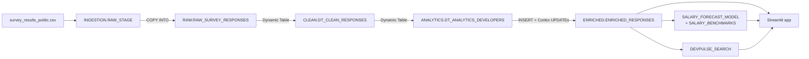
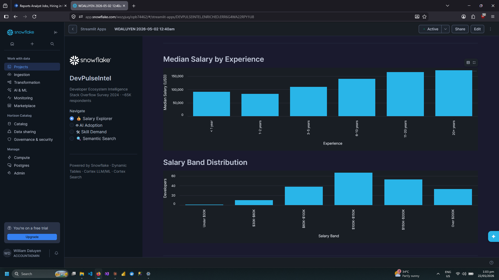
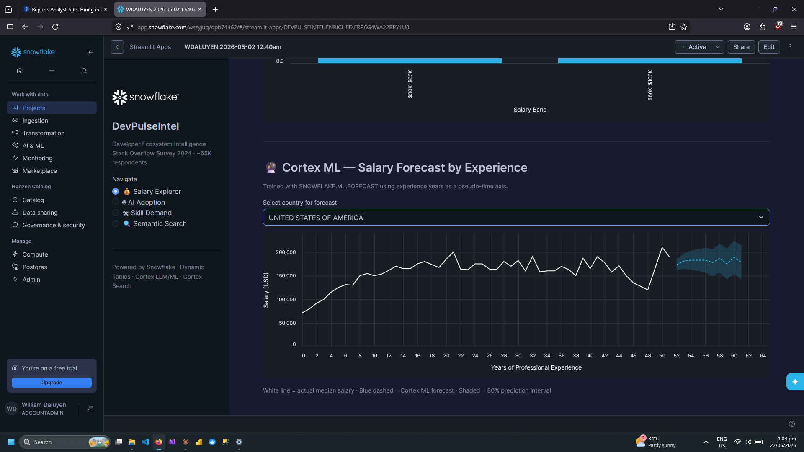

# DevPulseIntel

A **Snowflake Cortex capabilities demo** built on the Stack Overflow Developer Survey 2024 (65,437 respondents). Every layer runs on Snowflake-native services: no external orchestrator, storage, or compute. The repo also includes a documented post-build review.

> **Status:** Complete. Built in May 2026 on a Snowflake trial account that has since expired.
> The SQL and app code in this repo are **what ran**, with one exception: `app.py` predates a small NaN-handling fix made in the deployed app (see Known Issue 8). Issues found after the build are documented in [Known Issues & Post-Build Review](#known-issues--post-build-review) rather than patched, because patched code that was never executed would no longer match the results and screenshots.

---

## What It Demonstrates

| Snowflake Capability | Implementation |
|---|---|
| **Internal stage + pipe** | `RAW_STAGE` with a CSV file format. `SURVEY_PIPE` is defined (`AUTO_INGEST = FALSE`); the load ran via manual `COPY INTO` |
| **Dynamic Tables** | Medallion layers RAW → CLEAN → ANALYTICS, `TARGET_LAG = '9999 days'`, refreshed manually once |
| **Cortex LLM** | `SENTIMENT` on job satisfaction · `CLASSIFY_TEXT` for role standardization and AI attitude · `COMPLETE` (`mistral-7b`) for skill clustering |
| **Cortex ML** | `FORECAST` using years of experience as a pseudo-time axis (a capability demo, not a salary model; see Known Issues) |
| **Cortex Search** | `DEVPULSE_SEARCH` service over a composite developer-profile text column |
| **Streamlit in Snowflake** | Four-page app running on `DEVPULSE_APP_WH` |

---

## Architecture



Full object inventory: [`architecture.md`](./architecture.md). Design rationale: [`decisions.md`](./decisions.md).

---

## The Four Views

1. **Salary Explorer.** Filter by country and standardized role. Shows KPI cards, median salary by experience bucket, salary band distribution, the Cortex ML forecast chart, and a "Where Do I Stand?" percentile widget.
2. **AI Adoption Dashboard.** AI tool adoption rate by standardized role, AI attitude distribution (Cortex `CLASSIFY_TEXT`), AI job-threat perception, and job-satisfaction sentiment by role.
3. **Skill Demand Analyzer.** Median salary by skill cluster (Cortex `COMPLETE`), top 20 languages globally or by country, and skill cluster sizes.
4. **Semantic Search.** Natural-language search over developer profiles via Cortex Search, with country, skill-cluster, and AI-usage filters.

---

## Screenshots

### Salary Explorer: Experience & Distribution


### Cortex ML: Salary Forecast


---

## Project Structure

```
DevPulseIntel/
├── README.md                 # This file
├── BRD.md                    # Business requirements + post-build success review
├── architecture.md           # Object inventory, data flow, layer design
├── decisions.md              # Design decisions with post-build hindsight
├── setup.md                  # Step-by-step rebuild guide
├── DEVLOG.md                 # Build log: errors, fixes, lessons
│
├── sql/
│   ├── 01_staging.sql        # Database, schemas, warehouses, stage, RAW table, pipe
│   ├── 02_raw_load.sql       # COPY INTO the RAW table
│   ├── 03_dynamic_tables.sql # CLEAN and ANALYTICS Dynamic Tables + views
│   ├── 04_cortex_enrich.sql  # SENTIMENT, CLASSIFY_TEXT, COMPLETE enrichment
│   ├── 05_cortex_ml.sql      # FORECAST model, forecast results, salary benchmarks
│   └── 06_cortex_search.sql  # Cortex Search service
│
├── streamlit/
│   └── app.py                # Streamlit in Snowflake application
│
├── profiling/                # Post-build checks, run locally against the source CSV
│   ├── check_jobsat.py       # JobSat value distribution + estimated sentiment coverage
│   └── check_rowcount.py     # File integrity + which row definition matches ~23K
│
└── screenshots/
    ├── 01_salary_explorer_experience_and_bands.png
    └── 02_cortex_ml_salary_forecast.png
```

---

## Quick Start

1. Download the 2024 survey from https://survey.stackoverflow.co/ and extract `survey_results_public.csv`.
2. Follow [`setup.md`](./setup.md). It covers sampling and input profiling, which the original build skipped.
3. Run the SQL scripts in order, `01` through `06`.
4. Deploy `streamlit/app.py` as a Streamlit in Snowflake app.

Plan for roughly 2 hours end to end.

The scripts in `profiling/` need only Python and pandas. Put `survey_results_public.csv` in `data/` (it is not committed; it exceeds GitHub's file size limit), then run `python profiling/check_jobsat.py` from the repo root. To use a CSV elsewhere, pass its path as an argument.

---

## Cost Profile

The project is designed for a **one-time build with no ongoing compute**.

| Component | Approach | Cost driver |
|---|---|---|
| Warehouses | Four XS warehouses, 60s auto-suspend, split by workload | One-time build |
| Dynamic Tables | `TARGET_LAG = '9999 days'` | No scheduled refresh |
| Cortex LLM | Per-row function calls | Tokens × calls per row × rows |
| Cortex ML FORECAST | Single training run | One-time |
| Cortex Search | Indexed once (`TARGET_LAG = '9999 days'`) | Indexing + serving |
| Streamlit app | Runs on `DEVPULSE_APP_WH` | Per session, while the warehouse is running |

### Cost Retrospective

The original target was under $5. The build consumed **~$88 of trial credits**, of which ~$70 was AI_SERVICES (Cortex LLM). Post-build review found two root causes and one related data issue:

1. **No sampling.** Enrichment ran on every row in the ANALYTICS layer (~51.5K rows, estimated from the source CSV).
2. **Redundant calls.** `04_cortex_enrich.sql` calls `SENTIMENT` three times per row and `CLASSIFY_TEXT` / `COMPLETE` twice per row. It makes one call per derived column instead of one call per row.
3. **Spend on an unprofiled column.** `SENTIMENT` was applied to JobSat, which is a 0–10 integer in the 2024 survey (see Known Issues).

**What a rebuild would do (not executed; the trial expired):**
- Profile every enrichment input before calling any Cortex function (`SELECT DISTINCT ... LIMIT 20`).
- Run each Cortex step on 100 rows first, then extrapolate the cost before scaling.
- Apply sampling to the Cortex steps only, not to the seed table, so ML and benchmark tables keep full data (see `decisions.md` D-12).
- Call each Cortex function once per row and derive labels from the stored result.

Estimated AI_SERVICES cost for that rebuild: roughly **$3–4**. This is extrapolated from actuals and unverified.

**The lesson:** LLM cost scales with rows × calls per row × tokens per call. Warehouse size has nothing to do with it. Measure a small batch before you scale.

---

## Known Issues & Post-Build Review

The SQL in this repo is exactly what was executed. The trial account has since expired, so the issues below are documented rather than re-run. Items marked *(code review)* were found by reading the code and could not be confirmed against the live app.

**1. Redundant Cortex calls (cost).** See the Cost Retrospective. Corrected pattern, not executed:

```sql
UPDATE DEVPULSEINTEL.ENRICHED.ENRICHED_RESPONSES
SET JOB_SAT_SENTIMENT_SCORE = SNOWFLAKE.CORTEX.SENTIMENT(JOB_SAT)
WHERE JOB_SAT IS NOT NULL;

UPDATE DEVPULSEINTEL.ENRICHED.ENRICHED_RESPONSES
SET JOB_SAT_SENTIMENT_LABEL = CASE
    WHEN JOB_SAT_SENTIMENT_SCORE >  0.2 THEN 'Positive'
    WHEN JOB_SAT_SENTIMENT_SCORE < -0.2 THEN 'Negative'
    ELSE 'Neutral' END
WHERE JOB_SAT_SENTIMENT_SCORE IS NOT NULL;
```

**2. Sentiment applied to a numeric field.** The 2024 survey records JobSat as a 0–10 integer, not free text. This was confirmed by profiling the source CSV: 36,311 of 65,437 values are null, and the rest are 0–10. As a result:
- `SENTIMENT()` scored numeric strings, so `JOB_SAT_SENTIMENT_SCORE`, `JOB_SAT_SENTIMENT_LABEL`, and the "Sentiment by Role" chart carry no meaningful signal.
- The text-matching `JOB_SAT_SCORE` CASE in `03_dynamic_tables.sql` resolves to NULL.
- Root cause: the input column was not profiled before enrichment.

The correct approach (not executed) is to bucket the integer directly, with no LLM:

```sql
CASE
    WHEN TRY_CAST(JOB_SAT AS INT) BETWEEN 0 AND 3  THEN 'Dissatisfied'
    WHEN TRY_CAST(JOB_SAT AS INT) BETWEEN 4 AND 6  THEN 'Neutral'
    WHEN TRY_CAST(JOB_SAT AS INT) BETWEEN 7 AND 10 THEN 'Satisfied'
END
```

**3. The forecast is a capability demo, not a salary model.** `FORECAST` treats years of experience as a daily time axis. Predictions beyond the data's 51-year cap (the chart shows years 52–61) are extrapolation artifacts. The "Actual" line in the app does not apply the training view's `HAVING COUNT(*) >= 5` rule, so the tail (years 40–51) is noisy because of small cell counts.

**4. Pipe defined, not used for the load.** `SURVEY_PIPE` has `AUTO_INGEST = FALSE` and was never triggered. The data loaded through the manual `COPY INTO` in `02_raw_load.sql`. The pipe demonstrates configuration, not event-driven ingestion.

**5. "Where Do I Stand?" compares mismatched role labels** *(code review)*. The role dropdown lists `STANDARDIZED_ROLE` values (for example, "Backend Developer"), but the lookup filters `SALARY_BENCHMARKS.PRIMARY_DEV_ROLE`, which holds raw survey values (for example, "Developer, back-end"). The two label sets don't overlap, so the widget most likely returns "Not enough data" for every selection. It also picks the benchmark row whose median is closest to the entered salary, rather than matching on experience.

**6. "Professional developer" filter is broader than its name.** The ANALYTICS filter `MAIN_BRANCH LIKE '%developer%'` also matches the 2024 answers "I am not primarily a developer…" and "I used to be a developer by profession…". Measured on the source CSV, the filter keeps 51,525 rows; restricting to "I am a developer by profession" would keep 45,367. About 6,150 rows (~12%) are not professional developers, and each of them was also sent through Cortex enrichment.

**7. App input handling** *(code review)*. Filter values are interpolated into SQL f-strings, so a value containing a quote would break the query. The search query is embedded into the JSON payload unescaped, so a `"` in the query breaks the request. Fix: use Snowpark parameter binding (`session.sql(sql, params=[...])`) and build the payload with `json.dumps`.

**8. Minor.** `app.py` in this repo predates the `pd.notna()` guard applied to the KPI cards in the deployed app (see `DEVLOG.md`). Search test query 2 in `06_cortex_search.sql` filters on `"United States of America"`, but `COUNTRY` is uppercased in the CLEAN layer, so that test returns no rows.

---

## Scope & Limitations

- This is a demo on a static public dataset, built on a trial account. It is not a production system, and no stakeholder used it to make a decision.
- An independent rebuild from `setup.md` has not been performed.
- The forecast demonstrates the `FORECAST` API; it is not a valid model of salary growth.

---

## Skills Demonstrated

```
Snowflake Data Engineering
├── Staged ingestion (internal stage, file format, COPY INTO, pipe definition)
├── Declarative pipelines (Dynamic Tables, Medallion architecture)
├── SQL (DDL, DML, window/percentile functions, type casting, null handling)
└── Cost attribution (workload-separated warehouses, auto-suspend)

Snowflake AI / ML (Cortex)
├── LLM functions (SENTIMENT, CLASSIFY_TEXT, COMPLETE)
├── Cortex ML FORECAST
└── Cortex Search service

Application Development
└── Streamlit in Snowflake (four-page app, native deployment)

Engineering Practice
├── Post-build review: re-scored success criteria against source-data profiling
├── LLM cost root-cause analysis (row count × calls per row × tokens)
└── Documentation that separates what ran from what should change
```

---

## Author

**William Daluyen**
[LinkedIn](https://www.linkedin.com/in/wdaluyen/) · [GitHub](https://github.com/WDXII/)

---

*Built on a Snowflake trial · Data: Stack Overflow Developer Survey 2024 (ODbL) · Built May 2026 · Post-build review September 2026*
