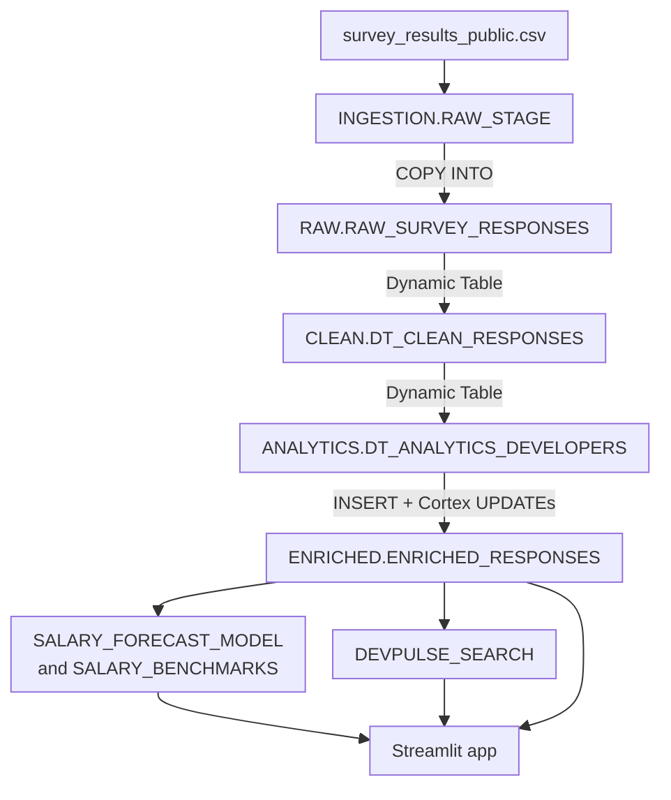

# DevPulseIntel

> A Snowflake-native analytics platform on the Stack Overflow Developer Survey 2024, built with Dynamic Tables, Cortex AI, and Streamlit in Snowflake

[](https://www.snowflake.com)
[](https://docs.snowflake.com/en/user-guide/snowflake-cortex/overview)
[](https://docs.snowflake.com/en/developer-guide/streamlit/about-streamlit)
[](https://survey.stackoverflow.co/)
[-lightgrey)](#known-issues--post-build-review)

> **Status:** Complete. Built May 2026 on a trial account that has since expired.
> The SQL and app code here are **what ran**, except `app.py`, which predates a small NaN fix made in the deployed app (Known Issue 8). Issues found afterward are documented under [Known Issues](#known-issues--post-build-review), not patched, so code, results, and screenshots stay consistent.

---

## What This Project Does

Most data engineering portfolios stop at ingestion and transformation. DevPulseIntel fills a specific gap: hands-on work with Snowflake-native AI/ML and the application layer, using only Snowflake services (no external orchestrator, storage, or compute).

It takes the 2024 Stack Overflow Developer Survey (65,437 respondents) through a Medallion pipeline and:

1. **Ingests** the survey CSV through an internal stage and `COPY INTO` (a pipe is defined but was never triggered)
2. **Cleans and filters** it with Dynamic Tables (RAW → CLEAN → ANALYTICS, 51,525 in-scope rows)
3. **Enriches** it with Cortex LLM functions (sentiment, role standardization, skill clustering)
4. **Models and searches** it with Cortex ML `FORECAST` and a Cortex Search service
5. **Surfaces** results in a four-page Streamlit in Snowflake app

It also includes a documented post-build review: defects and missed targets are recorded in [Results](#results-vs-success-criteria) and [Known Issues](#known-issues--post-build-review), not hidden.

---

## What It Demonstrates

Platform: a Snowflake trial account (since expired). Version control: GitHub.

| Capability | Implementation |
|---|---|
| **Stage + pipe** | `RAW_STAGE` with CSV file format. `SURVEY_PIPE` defined (`AUTO_INGEST = FALSE`); load ran via manual `COPY INTO` |
| **Dynamic Tables** | RAW → CLEAN → ANALYTICS, `TARGET_LAG = '9999 days'`, refreshed manually once |
| **Cortex LLM** | `SENTIMENT` (job satisfaction) · `CLASSIFY_TEXT` (roles, AI attitude) · `COMPLETE` with `mistral-7b` (skill clusters) |
| **Cortex ML** | `FORECAST` with experience as a pseudo-time axis (capability demo, not a salary model) |
| **Cortex Search** | `DEVPULSE_SEARCH` over a composite profile text |
| **Profiling** | Python 3 and pandas, post-build checks only (`profiling/`) |
| **Streamlit in Snowflake** | Four pages on `DEVPULSE_APP_WH`: Salary Explorer, AI Adoption, Skill Demand, Semantic Search |

---

## Architecture



Object inventory: [`architecture.md`](./architecture.md) · Design rationale: [`decisions.md`](./decisions.md)

---

## Pipeline Layers

| Layer | Schema / object | What happens |
|---|---|---|
| Ingestion | `INGESTION.RAW_STAGE`, `SURVEY_CSV_FORMAT`, `SURVEY_PIPE` | Internal stage and CSV file format; pipe defined with `AUTO_INGEST = FALSE` |
| RAW | `RAW.RAW_SURVEY_RESPONSES` | 114 survey columns, all VARCHAR, plus load metadata. Loaded by manual `COPY INTO` |
| CLEAN | `CLEAN.DT_CLEAN_RESPONSES` | Renames and casts columns; salary values under $100 or over $2M set to NULL |
| ANALYTICS | `ANALYTICS.DT_ANALYTICS_DEVELOPERS` | Filters to developers; derives experience buckets and salary bands |
| ENRICHED | `ENRICHED.ENRICHED_RESPONSES` | Materialized table: `INSERT` seed, then one Cortex `UPDATE` per task |
| ML | `SALARY_FORECAST_RESULTS`, `SALARY_BENCHMARKS` | `FORECAST` output (80% interval) and pre-aggregated percentiles |
| Search | `DEVPULSE_SEARCH` | Cortex Search over a composite profile text |
| App | `streamlit/app.py` | Salary Explorer, AI Adoption, Skill Demand, Semantic Search |

Full object inventory: [`architecture.md`](./architecture.md).

---

## Screenshots

Two of the four app pages were captured before the trial expired.


---

## Data Source

**Stack Overflow Developer Survey 2024**, 65,437 respondents, released under the ODbL. Download `survey_results_public.csv` from https://survey.stackoverflow.co/. The CSV is not in this repository (too large for GitHub).

---

## Project Structure

```
DevPulseIntel/
├── README.md
├── BRD.md
├── architecture.md
├── decisions.md
├── setup.md
├── DEVLOG.md
├── sql/
│   ├── 01_staging.sql
│   ├── 02_raw_load.sql
│   ├── 03_dynamic_tables.sql
│   ├── 04_cortex_enrich.sql
│   ├── 05_cortex_ml.sql
│   └── 06_cortex_search.sql
├── streamlit/
│   └── app.py
├── profiling/              # post-build checks
│   ├── check_jobsat.py
│   └── check_rowcount.py
├── screenshots/
│   ├── 01_salary_explorer_experience_and_bands.png
│   └── 02_cortex_ml_salary_forecast.png
└── data/                   # survey CSV goes here (not committed)
```

---

## Getting Started

**Prerequisites:** a Snowflake trial account with Cortex AI features available in its region, and the `ACCOUNTADMIN` role during setup.

1. Download the 2024 survey from https://survey.stackoverflow.co/ and extract `survey_results_public.csv`.
2. Follow [`setup.md`](./setup.md) (about 2 hours). It adds input profiling and sampling, which the original build skipped.
3. Run `sql/01`–`06` in order, then deploy `streamlit/app.py` as a Streamlit in Snowflake app.

The `profiling/` scripts need only Python and pandas. Put the CSV in `data/` (not committed) and run `python profiling/check_jobsat.py` from the repo root, or pass a path as an argument.

---

## Key Design Decisions

Full rationale and hindsight notes are in [`decisions.md`](./decisions.md).

| ID | Decision | Why |
|---|---|---|
| D-01 | Snowflake-native only | The goal is platform depth. Trade-off: no scheduling, tests, or CI |
| D-02 | Four-layer Medallion plus an `INGESTION` schema | Each script maps to one layer |
| D-03 | RAW stores everything as VARCHAR | Loads never fail on types. It also hid that JobSat is numeric |
| D-04 | `COPY INTO`; pipe defined, not triggered | One static file, so event-driven ingestion adds nothing |
| D-05 | Dynamic Tables with a 9999-day lag | Declarative pipeline with no refresh cost on a trial account |
| D-06 | Four XS warehouses split by workload | Cost is attributable per stage. Cortex LLM bills separately as AI_SERVICES |
| D-07 | Materialize Cortex outputs | A view would re-bill the LLM on every app query |
| D-08 | `CLASSIFY_TEXT` for roles, `COMPLETE` for clusters | Demonstrates all three LLM functions. A mapping table would be cheaper for roles |
| D-09 | Experience as a pseudo-time axis for `FORECAST` | `FORECAST` needs a time axis. Kept as a capability demo, not a valid salary model |
| D-10 | Pre-aggregated salary benchmarks | Instant, free lookups. The widget that reads them has a label mismatch (Known Issue 5) |
| D-11 | Cortex Search over a composite profile text | One searchable string per respondent, with categorical filter attributes |
| D-12 | Sample the Cortex enrichment | Revised twice and never executed. Profile inputs and pilot on ~100 rows first |
| D-13 | Document findings instead of patching | The trial expired, so code, results, and screenshots stay consistent |

---

## Cost Profile

Designed as a one-time build with no ongoing compute: four XS warehouses (60s auto-suspend), 9999-day lag on Dynamic Tables and Search, a single FORECAST training run. Cortex LLM cost = rows × calls per row × tokens per call.

### Cost Retrospective

The target was under $5. The build used **~$88 of trial credits**, ~$70 of it AI_SERVICES. Causes:

1. **No sampling.** Enrichment ran on every ANALYTICS row (51,525, estimated from the CSV).
2. **Redundant calls.** `04_cortex_enrich.sql` calls `SENTIMENT` 3× and `CLASSIFY_TEXT` / `COMPLETE` 2× per row: one call per derived column instead of one per row.
3. **Unprofiled input.** `SENTIMENT` ran on JobSat, a 0–10 integer (Known Issue 2).

**Rebuild plan (not executed):** profile every input first (`SELECT DISTINCT ... LIMIT 20`); pilot each Cortex step on 100 rows and extrapolate; sample only the Cortex steps, not the seed table (`decisions.md` D-12); call each function once per row and derive labels from the stored result. Estimated AI_SERVICES cost: **~$3–4** (extrapolated, unverified).

**Lesson:** warehouse size doesn't control LLM cost. Measure a small batch before you scale.

---

## Results vs. Success Criteria

Scored in [`BRD.md`](./BRD.md) §9 after the post-build review.

| Criterion | Status |
|---|---|
| Six Snowflake capabilities demonstrated | ✅ Met. The pipe was defined but the load ran via manual `COPY INTO` |
| Working Streamlit app (four views) | ✅ Met. One widget has a logic defect (Known Issue 5) |
| Enrichment materialized in tables | ✅ Met |
| Enrichment coverage | ❌ Sentiment not met (about 55.7% answered JobSat, and the input is numeric) |
| Cost-conscious enrichment | ❌ Not met. See [Cost Profile](#cost-profile) |
| Documentation consistent with code | ✅ Met after the v1.2 alignment |
| Reproducible from `setup.md` | ⚠️ Untested. No independent rebuild; the trial has expired |

---

## Skills Demonstrated

- **Data engineering:** staged ingestion, Dynamic Tables, Medallion architecture, SQL (window/percentile functions, casting, null handling), cost attribution
- **Snowflake AI/ML:** Cortex LLM functions, FORECAST, Cortex Search
- **Applications:** Streamlit in Snowflake (four pages)
- **Engineering practice:** post-build review against source-data profiling, LLM cost root-cause analysis, docs that separate what ran from what should change

---

## Documents

| Document | Purpose |
|---|---|
| [BRD.md](BRD.md) | Business requirements, scope, functional requirements with as-built notes, success criteria, risk register |
| [architecture.md](architecture.md) | Object inventory as actually created |
| [decisions.md](decisions.md) | Design decisions D-01 to D-13, with hindsight notes |
| [setup.md](setup.md) | Step-by-step rebuild guide, including the profiling and sampling steps the original build skipped |
| [DEVLOG.md](DEVLOG.md) | Build log and lessons learned |

---

## Known Issues & Post-Build Review

The SQL is exactly what was executed, and the trial has expired, so these are documented rather than re-run. Items marked *(code review)* come from reading the code and couldn't be confirmed against the live app.

**1. Redundant Cortex calls (cost).** See Cost Retrospective. Corrected pattern, not executed: compute once, derive the label from the stored score.
```sql
UPDATE DEVPULSEINTEL.ENRICHED.ENRICHED_RESPONSES
SET JOB_SAT_SENTIMENT_SCORE = SNOWFLAKE.CORTEX.SENTIMENT(JOB_SAT)
WHERE JOB_SAT IS NOT NULL;

UPDATE DEVPULSEINTEL.ENRICHED.ENRICHED_RESPONSES
SET JOB_SAT_SENTIMENT_LABEL = CASE
    WHEN JOB_SAT_SENTIMENT_SCORE >  0.2 THEN 'Positive'
    WHEN JOB_SAT_SENTIMENT_SCORE < -0.2 THEN 'Negative'
    ELSE 'Neutral' END
WHERE JOB_SAT_SENTIMENT_SCORE IS NOT NULL;
```

**2. Sentiment applied to a numeric field.** JobSat is a 0–10 integer (CSV profile: 36,311 of 65,437 null). `SENTIMENT()` scored numeric strings, so `JOB_SAT_SENTIMENT_SCORE`, `_LABEL`, and the "Sentiment by Role" chart carry no signal, and the text-matching `JOB_SAT_SCORE` CASE in `03_dynamic_tables.sql` resolves to NULL. Root cause: the input wasn't profiled. Correct approach (not executed): bucket the integer, no LLM.
```sql
CASE
    WHEN TRY_CAST(JOB_SAT AS INT) BETWEEN 0 AND 3  THEN 'Dissatisfied'
    WHEN TRY_CAST(JOB_SAT AS INT) BETWEEN 4 AND 6  THEN 'Neutral'
    WHEN TRY_CAST(JOB_SAT AS INT) BETWEEN 7 AND 10 THEN 'Satisfied'
END
```

**3. Forecast is a capability demo, not a salary model.** Experience is treated as a daily time axis, so predictions past the 51-year cap (chart years 52–61) are extrapolation artifacts. The app's "Actual" line skips the training view's `HAVING COUNT(*) >= 5`, so years 40–51 are noisy.

**4. Pipe defined, not used.** `SURVEY_PIPE` (`AUTO_INGEST = FALSE`) was never triggered; the load was the manual `COPY INTO` in `02_raw_load.sql`. It shows configuration, not event-driven ingestion.

**5. "Where Do I Stand?" role labels don't match** *(code review)*. The dropdown lists `STANDARDIZED_ROLE` values ("Backend Developer"), but the lookup filters `SALARY_BENCHMARKS.PRIMARY_DEV_ROLE`, which holds raw labels ("Developer, back-end"). The widget most likely returns "Not enough data" every time. It also picks the row with the closest median rather than matching on experience.

**6. "Professional developer" filter is too broad.** `MAIN_BRANCH LIKE '%developer%'` also matches "I am not primarily a developer…" and "I used to be a developer by profession…". It keeps 51,525 rows; "I am a developer by profession" alone keeps 45,367. About 6,150 (~12%) aren't professional developers, and all were billed for enrichment.

**7. App input handling** *(code review)*. Filter values go into SQL f-strings, and the search query goes unescaped into a JSON payload, so a quote breaks either. Fix: Snowpark parameter binding (`session.sql(sql, params=[...])`) and `json.dumps`.

**8. Minor.** `app.py` predates the `pd.notna()` KPI fix in the deployed app (see `DEVLOG.md`). Search test 2 in `06_cortex_search.sql` filters on `"United States of America"`, but `COUNTRY` is uppercased in CLEAN, so it returns no rows.

---

## Scope & Limitations

- A demo on a static public dataset, built on a trial account. Not a production system; no stakeholder used it for a decision.
- No independent rebuild from `setup.md` has been performed.
- The forecast demonstrates the `FORECAST` API; it isn't a valid model of salary growth.

---

**William Daluyen** · [LinkedIn](https://www.linkedin.com/in/wdaluyen/) · [GitHub](https://github.com/WDXII/)

*Built on a Snowflake trial · Data: Stack Overflow Developer Survey 2024 (ODbL) · Built May 2026 · Post-build review September 2026*
