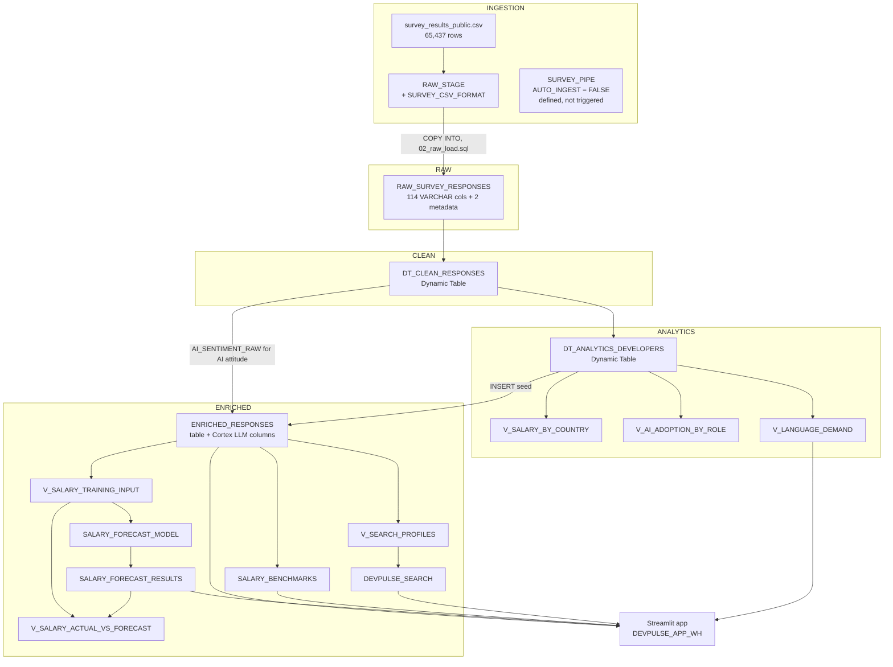

# Architecture: DevPulseIntel

**Built:** May 2026 · **Documented:** September 2026
Describes the objects actually created by `sql/01–06` and `streamlit/app.py`. Rationale: [`decisions.md`](./decisions.md). Defects: [README → Known Issues](./README.md#known-issues--post-build-review).

## 1. Principles
- **Snowflake-native only.** No external orchestration, storage, or compute.
- **Medallion layers.** RAW keeps source as-is, CLEAN types it, ANALYTICS applies business logic, ENRICHED holds AI/ML output.
- **Compute once, read many.** Cortex outputs are stored in tables; the app never calls an LLM at query time. Cortex Search is the exception by design.
- **No idle cost.** `TARGET_LAG = '9999 days'` on Dynamic Tables and the search service; XS warehouses with 60-second auto-suspend.

## 2. Data Flow

## 3. Object Inventory

**Database and schemas** (`01_staging.sql`): `DEVPULSEINTEL` with schemas `INGESTION` (stage, file format, pipe), `RAW`, `CLEAN`, `ANALYTICS`, `ENRICHED`.

**Warehouses** (`01_staging.sql`): all XS, `AUTO_SUSPEND = 60`, split by workload for cost attribution.

| Warehouse | Used by |
|---|---|
| `DEVPULSE_LOAD_WH` | `COPY INTO` (02) |
| `DEVPULSE_TRANSFORM_WH` | Dynamic Table refreshes (03) |
| `DEVPULSE_CORTEX_WH` | Enrichment, FORECAST training, Search indexing (04–06) |
| `DEVPULSE_APP_WH` | Streamlit queries |

**Ingestion** (`01`, `02`)

| Object | Notes |
|---|---|
| `INGESTION.SURVEY_CSV_FORMAT` | `SKIP_HEADER = 1`, optional `"` enclosure, `NULL_IF = ('NA','NULL','','N/A')` |
| `INGESTION.RAW_STAGE` | Internal stage; CSV uploaded manually |
| `INGESTION.SURVEY_PIPE` | `AUTO_INGEST = FALSE`; same `COPY` as script 02; never triggered |
| `RAW.RAW_SURVEY_RESPONSES` | 114 VARCHAR survey columns + `_SOURCE_FILE_NAME`, `_LOAD_TIMESTAMP`; "Check" → `CHECK_COL` |

Load: `COPY INTO` with positional `$1–$114`, `ON_ERROR = 'CONTINUE'`, `PURGE = FALSE`, `FORCE = FALSE`.

**Transformation** (`03`)

| Object | Logic |
|---|---|
| `CLEAN.DT_CLEAN_RESPONSES` | snake_case names; `COUNTRY` trimmed and uppercased; experience text → integer ("Less than 1 year" → 0, "More than 50 years" → 51); salary from `ConvertedCompYearly`, NULL if under $100 or over $2M; `WHERE RESPONSEID IS NOT NULL` |
| `ANALYTICS.DT_ANALYTICS_DEVELOPERS` | Filter `MAIN_BRANCH LIKE '%developer%'` and `DEV_TYPE NOT LIKE '%student%'`. Derives `SALARY_BAND` (6), `EXPERIENCE_BUCKET` (6), `PRIMARY_LANGUAGE`, `PRIMARY_DEV_ROLE`, `USES_AI_TOOLS`, `JOB_SAT_SCORE` |
| `V_SALARY_BY_COUNTRY` | Median/avg/P25/P75 per country (≥30 respondents) |
| `V_AI_ADOPTION_BY_ROLE` | Adoption rate by primary role (≥20) |
| `V_LANGUAGE_DEMAND` | Language counts by country (`LATERAL FLATTEN`); feeds Skill Demand |

**Enrichment** (`04`): `ENRICHED_RESPONSES` is a regular table, seeded with 23 passthrough columns, then filled by one `UPDATE` per Cortex task.

| Output | Function | Input | Output space |
|---|---|---|---|
| `JOB_SAT_SENTIMENT_SCORE` / `_LABEL` | `SENTIMENT` | `JOB_SAT` | −1 to 1; Positive (>0.2) / Neutral / Negative (<−0.2). **Input is numeric, so output is not meaningful** |
| `STANDARDIZED_ROLE` / `_SCORE` | `CLASSIFY_TEXT` | `DEV_TYPE` | Backend, Frontend, Full-Stack, Data Engineer / Analyst, DevOps / Platform, Mobile, Engineering Manager / Lead, Other Technical |
| `SKILL_CLUSTER` / `_RAW` | `COMPLETE` (`mistral-7b`) | `LANGUAGE_HAVE_WORKED_WITH` | Web & JavaScript, Data & Python, Systems & Low-Level, Cloud & DevOps, Mobile & Cross-Platform, Enterprise & JVM, Full-Stack Generalist, Other (non-conforming → Other) |
| `AI_ATTITUDE_CATEGORY` | `CLASSIFY_TEXT` | `CLEAN.AI_SENTIMENT_RAW` | Enthusiast, Cautious, Skeptic, Neutral |

As written, `SENTIMENT` runs 3× and `CLASSIFY_TEXT` (roles) and `COMPLETE` 2× per row (Known Issue 1). Enrichment ran on all ANALYTICS rows, unsampled.

**Machine learning** (`05`)

| Object | Notes |
|---|---|
| `V_SALARY_TRAINING_INPUT` | Median salary per (country, years of experience); timestamp = `2000-01-01 + N days`; cells need ≥5 respondents |
| `SALARY_FORECAST_MODEL` | `SNOWFLAKE.ML.FORECAST`, series = country, `ON_ERROR = 'SKIP'` |
| `SALARY_FORECAST_RESULTS` | 10 periods per country, 80% interval; filled via `RESULT_SCAN(LAST_QUERY_ID())` |
| `SALARY_BENCHMARKS` | P25/median/avg/P75/P90 by country × experience bucket × `PRIMARY_DEV_ROLE` (≥10) |
| `V_SALARY_ACTUAL_VS_FORECAST` | Actuals UNION forecast; not read by the app |

**Search** (`06`): `V_SEARCH_PROFILES` builds `PROFILE_TEXT` (role, cluster, languages, databases, platforms, country, experience, salary band, JobSat, AI attitude) for rows with non-null `SKILL_CLUSTER`. `DEVPULSE_SEARCH` indexes `PROFILE_TEXT` with 9 filter attributes (country, both role columns, cluster, experience bucket, salary band, sentiment label, AI attitude, `USES_AI_TOOLS`); `TARGET_LAG = '9999 days'`.

**Application** (`streamlit/app.py`): in `DEVPULSEINTEL.ENRICHED` on `DEVPULSE_APP_WH`; results cached 1 hour (`st.cache_data(ttl=3600)`).

| Page | Reads from |
|---|---|
| Salary Explorer | `ENRICHED_RESPONSES`, `SALARY_FORECAST_RESULTS`, `SALARY_BENCHMARKS` |
| AI Adoption | `ENRICHED_RESPONSES` (role, attitude, job threat, sentiment) |
| Skill Demand | `ENRICHED_RESPONSES` (`SKILL_CLUSTER`), `V_LANGUAGE_DEMAND` |
| Semantic Search | `DEVPULSE_SEARCH` via `SEARCH_PREVIEW` |

## 4. Row Counts
Build-time counts weren't retained; these are estimates from the source file.

| Layer | Count | Basis |
|---|---|---|
| Source CSV | 65,437 | pandas profile |
| RAW / CLEAN (expected) | 65,437 | every record has 114 fields, no embedded newlines |
| ANALYTICS / ENRICHED | 51,525 | ANALYTICS filter applied to the CSV |
| …with a valid salary | 23,094 | the app's "Developers" KPI card, no filters |

## 5. Cost

| Source | Control | Outcome |
|---|---|---|
| Warehouses | XS, 60s suspend, one per workload | Small share |
| Dynamic Tables | 9999-day lag, one manual refresh | One-time |
| Cortex LLM (AI_SERVICES) | **None applied** | ~$70 of ~$88 total |
| FORECAST training | Single run | One-time |
| Cortex Search | 9999-day lag | Indexed once; per-query serving |

Analysis: [README → Cost Retrospective](./README.md#cost-retrospective) and `decisions.md` D-12.
