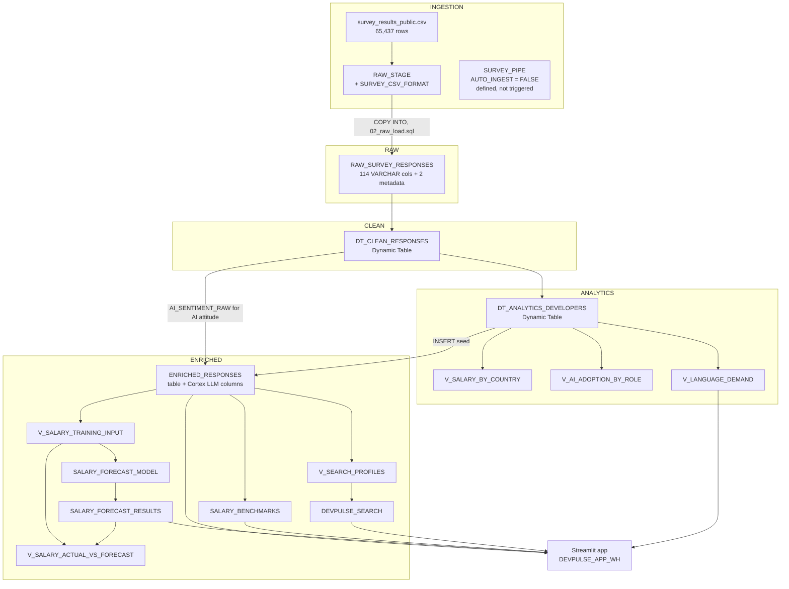

# Architecture: DevPulseIntel

**As built:** May 2026 · **Documented:** September 2026
This document describes the objects that were actually created by `sql/01–06` and `streamlit/app.py`. Design rationale is in [`decisions.md`](./decisions.md). Known defects are in [`README.md` → Known Issues](./README.md#known-issues--post-build-review).

---

## 1. Principles

- **Snowflake-native only.** No external orchestration, storage, or compute.
- **Medallion layering.** Each schema has one job: RAW keeps the source as-is, CLEAN types it, ANALYTICS applies business logic, and ENRICHED holds AI/ML output.
- **Compute once, read many.** Cortex outputs are materialized into tables; the app never calls an LLM at query time. (Cortex Search is the exception: it is a query-time service by design.)
- **No idle cost.** Dynamic Tables and the search service use `TARGET_LAG = '9999 days'`; warehouses are XS with 60-second auto-suspend.

---

## 2. Data Flow

---

## 3. Object Inventory

### Database and schemas (`01_staging.sql`)

| Object | Purpose |
|---|---|
| `DEVPULSEINTEL` | Project database |
| `INGESTION` | Stage, file format, pipe |
| `RAW` | Source data as-is |
| `CLEAN` | Typed, renamed, null-handled data |
| `ANALYTICS` | Business logic and reporting views |
| `ENRICHED` | Cortex LLM/ML/Search outputs |

### Warehouses (`01_staging.sql`)

All XS, `AUTO_SUSPEND = 60`, `AUTO_RESUME = TRUE`. They are split by workload so costs can be attributed.

| Warehouse | Used by |
|---|---|
| `DEVPULSE_LOAD_WH` | `COPY INTO` (script 02) |
| `DEVPULSE_TRANSFORM_WH` | Dynamic Table refreshes (script 03) |
| `DEVPULSE_CORTEX_WH` | Cortex enrichment, FORECAST training, Cortex Search indexing (scripts 04–06) |
| `DEVPULSE_APP_WH` | Streamlit app queries |

### Ingestion (`01_staging.sql`, `02_raw_load.sql`)

| Object | Type | Notes |
|---|---|---|
| `INGESTION.SURVEY_CSV_FORMAT` | File format | `SKIP_HEADER = 1`, optional `"` enclosure, `NULL_IF = ('NA','NULL','','N/A')` |
| `INGESTION.RAW_STAGE` | Internal stage | CSV is uploaded here manually |
| `INGESTION.SURVEY_PIPE` | Pipe | `AUTO_INGEST = FALSE`; same `COPY` definition as script 02; never triggered |
| `RAW.RAW_SURVEY_RESPONSES` | Table | 114 survey columns (VARCHAR) + `_SOURCE_FILE_NAME`, `_LOAD_TIMESTAMP`. CSV column "Check" is renamed `CHECK_COL` |

The load is `COPY INTO` with positional `$1–$114` mapping, `ON_ERROR = 'CONTINUE'`, `PURGE = FALSE`, and `FORCE = FALSE`.

### Transformation (`03_dynamic_tables.sql`)

| Object | Type | Logic |
|---|---|---|
| `CLEAN.DT_CLEAN_RESPONSES` | Dynamic Table, lag 9999 days | Renames to snake_case; `COUNTRY` trimmed and uppercased; experience text → integer ("Less than 1 year" → 0, "More than 50 years" → 51); salary from `ConvertedCompYearly`, with values under $100 or over $2M set to NULL; `WHERE RESPONSEID IS NOT NULL` |
| `ANALYTICS.DT_ANALYTICS_DEVELOPERS` | Dynamic Table, lag 9999 days | Filter: `MAIN_BRANCH LIKE '%developer%'` and `DEV_TYPE NOT LIKE '%student%'`. Derives `SALARY_BAND` (6 bands), `EXPERIENCE_BUCKET` (6 buckets) with sort keys, `PRIMARY_LANGUAGE` and `PRIMARY_DEV_ROLE` (first value of the semicolon list), `USES_AI_TOOLS`, `JOB_SAT_SCORE` |
| `ANALYTICS.V_SALARY_BY_COUNTRY` | View | Median/avg/P25/P75 salary per country (≥30 respondents) |
| `ANALYTICS.V_AI_ADOPTION_BY_ROLE` | View | AI adoption rate by primary role (≥20 respondents) |
| `ANALYTICS.V_LANGUAGE_DEMAND` | View | Language usage count by country (`LATERAL FLATTEN` on the language list). Used by the Skill Demand page |

### Enrichment (`04_cortex_enrich.sql`)

`ENRICHED.ENRICHED_RESPONSES` is a regular table. It is seeded with 23 passthrough columns from ANALYTICS, then filled by one `UPDATE` per Cortex task.

| Output column(s) | Function | Input | Output space |
|---|---|---|---|
| `JOB_SAT_SENTIMENT_SCORE`, `JOB_SAT_SENTIMENT_LABEL` | `SENTIMENT` | `JOB_SAT` | Score −1 to 1; label Positive (>0.2) / Neutral / Negative (<−0.2). **Input is numeric in the 2024 survey, so the output is not meaningful** |
| `STANDARDIZED_ROLE`, `STANDARDIZED_ROLE_SCORE` | `CLASSIFY_TEXT` | `DEV_TYPE` | Backend, Frontend, Full-Stack, Data Engineer / Analyst, DevOps / Platform, Mobile, Engineering Manager / Lead, Other Technical |
| `SKILL_CLUSTER`, `SKILL_CLUSTER_RAW` | `COMPLETE` (`mistral-7b`) | `LANGUAGE_HAVE_WORKED_WITH` | Web & JavaScript, Data & Python, Systems & Low-Level, Cloud & DevOps, Mobile & Cross-Platform, Enterprise & JVM, Full-Stack Generalist, Other. Non-conforming responses are mapped to Other |
| `AI_ATTITUDE_CATEGORY` | `CLASSIFY_TEXT` | `CLEAN.AI_SENTIMENT_RAW` | Enthusiast, Cautious, Skeptic, Neutral |

As written, the script calls `SENTIMENT` three times per row and `CLASSIFY_TEXT` (roles) and `COMPLETE` twice per row (README Known Issue 1). Enrichment ran on all ANALYTICS rows, unsampled.

### Machine learning (`05_cortex_ml.sql`)

| Object | Type | Notes |
|---|---|---|
| `ENRICHED.V_SALARY_TRAINING_INPUT` | View | Median salary per (country, years of experience); the timestamp is `2000-01-01 + N days`; cells need ≥5 respondents |
| `ENRICHED.SALARY_FORECAST_MODEL` | `SNOWFLAKE.ML.FORECAST` | Series = country; `ON_ERROR = 'SKIP'` for series with too little data |
| `ENRICHED.SALARY_FORECAST_RESULTS` | Table | 10 forecast periods per country, 80% prediction interval. Filled via `RESULT_SCAN(LAST_QUERY_ID())` |
| `ENRICHED.SALARY_BENCHMARKS` | Table | P25/median/avg/P75/P90 by country × experience bucket × `PRIMARY_DEV_ROLE` (≥10 respondents) |
| `ENRICHED.V_SALARY_ACTUAL_VS_FORECAST` | View | Training actuals UNION forecast. Not read by the app, which computes actuals itself |

### Search (`06_cortex_search.sql`)

| Object | Type | Notes |
|---|---|---|
| `ENRICHED.V_SEARCH_PROFILES` | View | Builds `PROFILE_TEXT` from role, cluster, languages, databases, platforms, country, experience, salary band, JobSat, and AI attitude. Only rows with non-null `SKILL_CLUSTER` |
| `ENRICHED.DEVPULSE_SEARCH` | Cortex Search service | `ON PROFILE_TEXT`; filter attributes: `COUNTRY`, `PRIMARY_DEV_ROLE`, `STANDARDIZED_ROLE`, `SKILL_CLUSTER`, `EXPERIENCE_BUCKET`, `SALARY_BAND`, `JOB_SAT_SENTIMENT_LABEL`, `AI_ATTITUDE_CATEGORY`, `USES_AI_TOOLS`. `TARGET_LAG = '9999 days'` |

### Application (`streamlit/app.py`)

Deployed in `DEVPULSEINTEL.ENRICHED` on `DEVPULSE_APP_WH`. Query results are cached for one hour (`st.cache_data(ttl=3600)`).

| Page | Reads from |
|---|---|
| Salary Explorer | `ENRICHED_RESPONSES` (KPIs, experience and band charts, forecast actuals), `SALARY_FORECAST_RESULTS`, `SALARY_BENCHMARKS` |
| AI Adoption | `ENRICHED_RESPONSES` (adoption by `STANDARDIZED_ROLE`, `AI_ATTITUDE_CATEGORY`, `AI_THREAT_JOB`, sentiment by role) |
| Skill Demand | `ENRICHED_RESPONSES` (`SKILL_CLUSTER`), `ANALYTICS.V_LANGUAGE_DEMAND` |
| Semantic Search | `DEVPULSE_SEARCH` via `SNOWFLAKE.CORTEX.SEARCH_PREVIEW` |

---

## 4. Row Counts

| Layer | Count | Source |
|---|---|---|
| Source CSV | 65,437 | Local pandas profile |
| RAW / CLEAN (expected) | 65,437 | Source file check: every record has 114 fields, no embedded newlines |
| ANALYTICS / ENRICHED | ~51.5K (51,525) | ANALYTICS filter applied to the source CSV in pandas |
| … of which have a valid salary | ~23.1K (23,094) | The figure shown on the app's "Developers" KPI card with no filters |

Build-time counts were not retained, so these are estimates from the source file.

---

## 5. Cost Architecture

| Cost source | Control | Outcome |
|---|---|---|
| Warehouse compute | XS size, 60s auto-suspend, one warehouse per workload | Small share of total |
| Dynamic Table refresh | 9999-day lag, one manual refresh | One-time |
| Cortex LLM (AI_SERVICES) | **None applied in the build** | ~$70 of ~$88 total trial credits |
| FORECAST training | Single run | One-time |
| Cortex Search | 9999-day lag | Indexed once; serving cost per query |

The missing control on Cortex LLM spend is analyzed in `README.md` → Cost Retrospective and `decisions.md` D-12.
